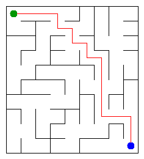

# Assignment 3. Maze Escape

Student ID: 253447
Name: Tumar
Group: SE - 2510

## Program output

The 13 lines your program prints on your data (`java -cp out Main`):

    Broken: 89
    Kept: 72
    Last broken wall: 110
    MST cost: 28449
    Heaviest broken wall: 837
    Path length: 17
    DFS visited: 38
    Dead ends: 28
    Zones: 10
    Largest zone: 16
    Is DAG: 0
    Flow stages: 8
    Fastest route cost: 14

My maze:

## Questions

Mission 0. What do find and union do, and what makes them fast in your code?

`find(x)` identifies the representative root of the set containing element `x`, while `union(a, b)` merges the sets of `a` and `b` if they belong to different components. They are fast because path compression flattens the tree during traversal, and union by size always links the root of the smaller tree beneath the root of the larger one, yielding an amortized complexity of $O(\alpha(n))$ per operation.

Mission 1. Why is Broken always R*C - 1, and Kept always (R-1)*(C-1)?

The cells form an undirected grid graph with $V = R \cdot C$ vertices. A spanning tree connecting all cells without cycles must contain exactly $V - 1 = R \cdot C - 1$ edges, which corresponds to the number of broken walls. Since the total number of inner walls is $W = R(C - 1) + C(R - 1) = 2RC - R - C$, the number of intact walls is always $W - \text{Broken} = (2RC - R - C) - (RC - 1) = (R - 1)(C - 1)$.

Mission 2. My MST cost from Kruskal and from Prim, and why they are equal:

Both Kruskal and Prim produced an identical MST cost of 28449. All wall costs in the input file are strictly distinct, which guarantees that the minimum spanning tree is unique. Furthermore, both algorithms are provably optimal greedy methods for finding minimum spanning trees.

Mission 3. Why is there exactly one path between two cells? How did you avoid a stack overflow on a huge maze?

The maze of Mission 1 is a spanning tree, which is a connected graph with no cycles, so every pair of vertices has exactly one simple path between them. To prevent a `StackOverflowError` on large mazes of 1000x1000 cells, recursion was replaced by an iterative DFS implementation using explicit array-based stacks.

Mission 4. Why does the second pass of Kosaraju go on the reversed graph? Why do the slides have no cycle exactly when Zones equals the number of cells?

Traversing the reversed graph prevents the search from leaking outside the component, because reversing edges turns component sources into sinks in the condensation DAG. If the slides contain no directed cycles, no two cells can reach each other mutually, meaning every cell is an SCC of size 1, so the number of zones equals the number of cells.

Mission 5. Why is it enough to go through the zones in the order of their numbers? What does this pass cost?

Kosaraju's second pass numbers the zones in their topological order, ensuring that any inter-zone slide only moves from a lower zone index to a higher one. This enables computing both flow stages (longest path) and the fastest route using dynamic programming in a single forward pass without a priority queue, costing $O(Z + S_{inter})$ time and space, where $Z$ is the number of zones and $S_{inter} \le S$ is the number of inter-zone slides.

## Timing (Mission 7)

Milliseconds, 5 runs each, from `java -cp out Bench`.

| maze | Kruskal | Prim |
|---|---|---|
| 100 x 100 | 7 | 6 |
| 300 x 300 | 41 | 33 |
| 1000 x 1000 | 442 | 728 |

What do the numbers say about how the time grows? Two or three sentences.

On smaller mazes (100x100 and 300x300), Prim's algorithm runs slightly faster due to lower constant overhead and cache locality. However, on the 1000x1000 maze ($10^6$ vertices, $\approx 2 \cdot 10^6$ walls), Kruskal is faster (442 ms vs 728 ms) because sorting edges and nearly $O(1)$ DSU operations scale very efficiently, whereas Prim incurs frequent heap insert and decrease-key overhead across millions of priority queue operations.

## Complexity

n is the number of cells, m the number of walls (or slides). Fill in every algorithm you wrote.

| algorithm | time | space | assumptions |
|---|---|---|---|
| DSU find and union | $O(\alpha(n))$ | $O(n)$ | Union by size and path compression |
| Kruskal | $O(m \log m)$ | $O(n + m)$ | Sorting all walls by cost + DSU cycle checks |
| Prim | $O(m \log n)$ | $O(n + m)$ | Binary heap PriorityQueue on grid adjacency |
| DFS | $O(n)$ | $O(n)$ | Iterative stack on spanning tree ($m = n - 1$) |
| Kosaraju | $O(n + m)$ | $O(n + m)$ | Two passes of iterative DFS with direct and transposed lists |
| Route in the zone graph | $O(Z + m)$ | $O(Z + m)$ | DP over topological order of zone DAG ($Z \le n$) |

